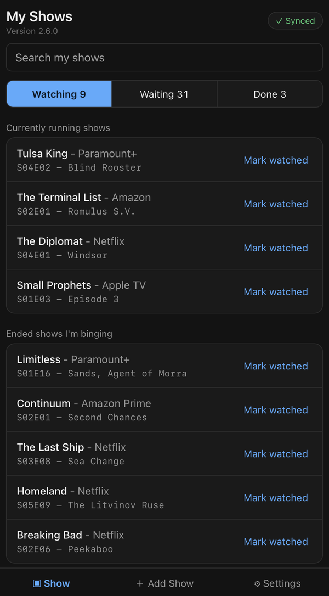
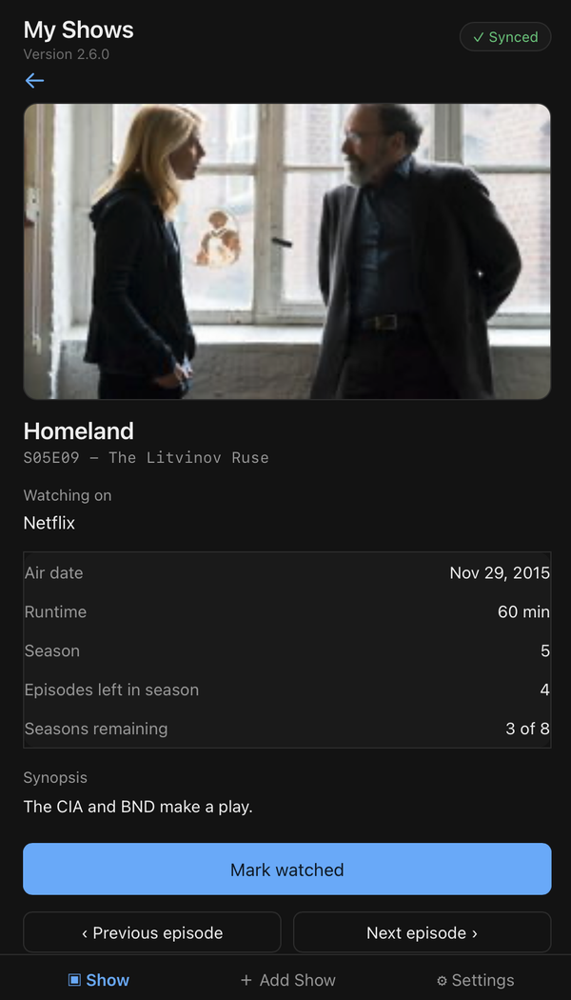
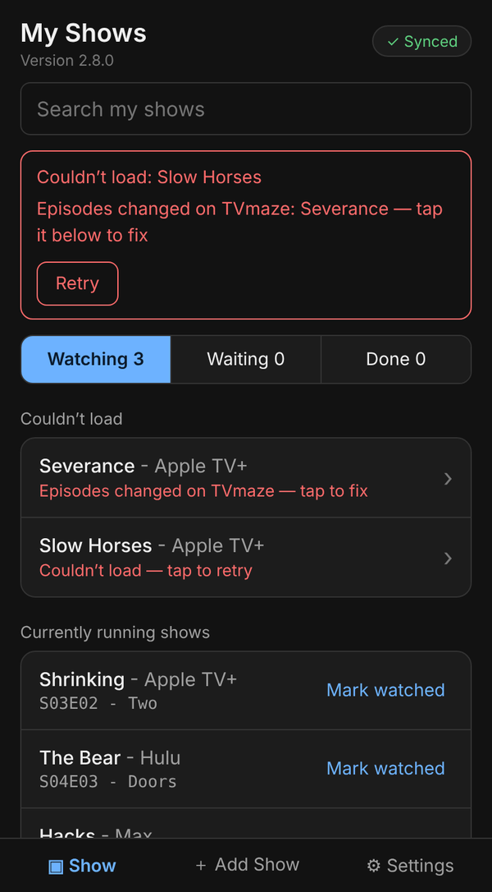

# My Shows V2

A simple TV episode tracker that keeps your list the same on all your devices: keep a list of shows you're watching, mark episodes watched, and always see what's next.

Hosted at **https://v2.myshows.fyi**

## V2 vs V1

**V1 and V2 are totally separate apps.** They have separate code, separate websites, and separate data.

- **V2 is for automatic multi-device sync.** Your list is kept in your own GitHub Gist, so your iPhone, iPad and Mac all show the same list without any manual backup files. V2 also has some UI cleanups.
- **Moving from V1 is one-way, by backup file.** Download a backup in V1, then restore it in V2 (Settings › Backup & restore). Shows that can't come across — ones with no "Watching on" platform (required in V2), or saved by a much older version of V1 — are left out and listed with the reason so you can add them again. Nothing is copied automatically, and nothing ever goes from V2 back to V1.
- **V1 keeps working, unchanged**, at https://myshows.fyi.

| | V1 | V2 |
| --- | --- | --- |
| Address | myshows.fyi | v2.myshows.fyi |
| Code | [CyberAdvisor/MyShows](https://github.com/CyberAdvisor/MyShows) | [CyberAdvisor/MyShows-v2](https://github.com/CyberAdvisor/MyShows-v2) |
| Where your list is stored | This browser only | Your own GitHub Gist, synced to all your devices |
| Multi-device | Manual backup file export/import | Automatic |
| Requires | Nothing | A free GitHub account and a classic token with the `gist` scope |
| Main screen | Available now / Upcoming / Pending return / Completed | Watching / Waiting / Done, with a count on each; Watching is split into "Currently running shows" and "Ended shows I'm binging"; Waiting is split into "Waiting for next episode or season" and "Suspended" |
| Navigation | Header icons | Bottom tool bar: Show / Add Show / Settings |
| Moving a list between them | Download a backup file | Restore a V1 backup file in Settings › Backup & restore (one-way, V1 → V2) |

## What it does

<p align="center">
  
  &nbsp;&nbsp;
  
</p>
<p align="center"><em>Your shows, split into what's on now and what you're binging &nbsp;·&nbsp; Every episode, with where you're up to</em></p>
<p align="center">
  
</p>
<p align="center"><em>If a show can't be loaded, it's named, not hidden, so you can retry or fix it</em></p>

- **Add a show** by searching (data comes from [TVmaze](https://www.tvmaze.com), a free public TV database — no TVmaze account or API key needed)
- **See which show didn’t load.** If TVmaze can’t supply a show’s details, it’s listed by name so you can retry it, or delete it if TVmaze no longer has it. If TVmaze changes a show’s episodes so your place can’t be found, the app tells you where you were instead of starting over
- **Say where you're up to** when you add a show: **Starting**, **Season/Episode last watched** (enter the season and episode), or **Caught Up** (the default — every aired episode is marked watched, handy for shows you're waiting on to return). The app figures out what's next and puts the show in the right group automatically, highlights it there, and confirms where it went
- **Note where you're watching it** (Hulu, Netflix, whatever) — required when adding; shown next to the show name and on the episode detail screen
- **Three groups**, each with a count:
  - **Watching** — the next episode has already aired, in two sections: **Currently running shows** (newest release first) and **Ended shows I'm binging** (the one you just watched moves to the bottom)
  - **Waiting** — you're caught up and the show is still in production (with a countdown when the next air date is known), plus a separate **Suspended** section for shows you've paused
  - **Done** — the series has ended and you've watched every episode
- **Search your list** from the top of the main screen; results cover all three groups and show which group each show is in
- **Includes specials** (Christmas specials, series finales tagged as specials, etc.) in their correct place in the timeline, based on air date
- **One tap to mark watched**, which then shows the next episode
- **Previous / Next episode** on a show's detail screen move where you're up to back one episode (to undo an accidental "Mark watched") or forward one (to skip an episode)
- **Suspend a series without deleting it** — from the detail screen, tap "Suspend series" to move a show into Waiting › Suspended, with your last watched episode and the date recorded. Tap "Reactivate" to pick back up exactly where you left off
- **Syncs automatically** — every change is saved on your device immediately and sent to your gist about two seconds later. When you open the app on another device, it picks up the latest list

The version number is shown under "My Shows" on every screen; tap it to see the changelog. The guide says which version it describes.

## Getting started

1. Have a free [GitHub](https://github.com) account.
2. Create a token (steps below).
3. Open https://v2.myshows.fyi, paste the token, and tap **Connect**.

The first time you connect, My Shows creates a secret gist in your GitHub account to hold your list. On your other devices, connect with the same token (or another token from the same account) and the app finds that gist and loads your list.

### Creating your GitHub token

1. On GitHub, open your profile picture menu → **Settings** → **Developer settings** → **Personal access tokens** → **Tokens (classic)**.
2. Choose **Generate new token (classic)**.
3. Give it a name such as `My Shows`, and choose an expiration.
4. Tick only the **gist** scope.
5. Choose **Generate token** and copy it straight away — GitHub shows it only once. Keep it in your password manager or Notes so you can paste it on your iPhone and iPad.

Only **classic** tokens are supported.

If your token expires or is revoked, the app keeps working from the copy on your device and shows **Sync error — token rejected**. Create a new token and enter it in **Settings › Sync › Change token**.

## Your gist — read this

- **What it is.** A secret gist named **My Shows V2**, holding one file, `myshows.json`. It is your list. **Don't delete it** — deleting it removes your list from every device the next time they sync. (If it does get deleted, **Settings › Sync › Recreate gist** makes a new one from the list on the device you're holding.)
- **More than one.** If your account ever has more than one My Shows list (for example after "Start a new gist"), the app asks which one to use when you connect a new device, showing each list's show count and last-updated date. To remove one you don't want, open [gist.github.com](https://gist.github.com), open that gist, and choose **Delete**.
- **Secret is not private.** Secret gists are unlisted, so they don't appear in search or on your public profile, but anyone who has the gist's URL can view it.
- **What the token can do.** A classic token with the `gist` scope can read and write **all** of your gists, not just the My Shows one. Treat it like a password.
- **Token lifetime.** GitHub automatically revokes tokens that go unused for a year, and tokens with an expiration date stop working on that date.

## Data storage and privacy

- **Your list lives in your own gist**, with a working copy in your browser's local storage on each device. There is no My Shows server and no shared database.
- **Show details are saved on each device** (episode names and air dates from TVmaze, in local storage) so your list opens instantly. They are never sent to your gist or put in backups, and are removed when you delete a show or disconnect the device.
- **Your token is stored only on your device** (in local storage) and is sent only to GitHub.
- **Sync is last-write-wins.** The most recent change wins; there's no merging of edits made at the same moment on two devices.
- **Offline is fine.** Changes are saved on the device and sent to your gist when you're back online.
- **Network requests the app makes:**
  - `api.tvmaze.com` — show and episode data (no account, no key)
  - `api.github.com` and `gist.githubusercontent.com` — reading and writing your gist
  - **Statcounter**, a third-party web analytics service, installed to help debug access issues (e.g. confirming the site is reachable, spotting broken deploys) rather than to profile visitors. The visible badge is set to invisible (`sc_invisible=1`) but the tracking script still runs. It never sees your list or your token. If you self-host `index.html`, you can remove the Statcounter block from the `<head>`.
- **The code being public does not expose your data.** The repository holds only the app; your list is in your gist.

## Backup and restore

Your list is already stored in your gist, so backups are optional. In **Settings › Backup & restore**:

- **Download backup file** — saves a `.json` copy of your whole list. On iPhone this opens Safari's file preview; tap **More...** → **Save to Files**.
- **Choose backup file** — replaces your whole list with the one in the file, after a confirmation. Because the list syncs, the replacement reaches all your devices.
- **V1 backup files** can be restored too. As with any restore, the V1 shows replace your whole V2 list after you confirm. Shows that can't come across (ones with no "Watching on" platform (required in V2), or saved by a much older version of V1) are left out and listed afterwards, with the reason, so you can add them again.

## Disconnecting a device

**Settings › Sync › Disconnect this device** removes your token and the list from that device only. The list stays in your gist; connecting again with your token loads it back.

## How it's built

A single self-contained `index.html` file — plain HTML, CSS, and JavaScript. No build step, no framework, no dependencies to install. It calls the public TVmaze API and the GitHub Gist API directly from your browser.

## Hosting your own copy on GitHub Pages

This needs to run from a real `https://` web address — iOS Safari blocks network requests from local files.

1. Create a **public** repository on GitHub.
2. Upload `index.html` (and `guide/` and `changelog/` if you want them).
3. Go to **Settings → Pages**, set Source to **Deploy from a branch**, branch `main`, folder `/ (root)`, and save.
4. After a minute or so, open the URL GitHub gives you on your phone, then use Safari's **Share → Add to Home Screen**.

If you host a copy under your own address, change the addresses in `sitemap.xml` and `robots.txt` to yours, or delete those two files.

A self-hosted copy is a different web address, so it has its own device copy and needs connecting with your token once — your gist is the same either way.

## Testing

```sh
npm install jsdom
node logic.test.js
node app.test.js
```

`logic.test.js` unit-tests the pure logic, read straight out of `index.html`. `app.test.js` loads the real `index.html` into jsdom with mocked TVmaze and GitHub APIs and drives it through setup, adding shows, segments, search, sync, every sync failure, shows that can’t be loaded from TVmaze (named, retried or deleted; requests sent at once and paced only after TVmaze refuses one; a time limit), episodes changed on TVmaze, the local date, refreshing on return to the app, and a damaged copy on the device.

## Customizing this with Claude

This app was built with [Claude](https://claude.ai). `CLAUDE.md` is the V2 design document: every requirement, decision and screen mockup, plus the rules for changing the app. `AGENTS.md` has the short contributor rules. Start a new conversation with Claude, give it those two files, and describe the change you want.
